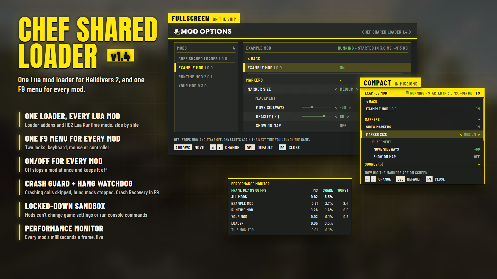

# Chef Shared Loader

**Download:** `Chef-Shared-Loader-1.4.0.zip` from the [latest release](https://github.com/Th3chef/Chef-Shared-Loader/releases/latest) (not the source code). **Mod makers:** [docs/MODDING.md](docs/MODDING.md).

**Install:** add the zip in your mod manager and enable it, **give it the highest priority** so it wins over every other
mod (in Arsenal with "First mod highest priority", put it at the top of the list; with "Last mod highest priority", at
the bottom), then Purge and Deploy. If a mod that replaces the game's `boot` script has a higher priority, it takes the
loader's place and no loader mod runs, unless that mod's `boot` is the loader's start-up stub (see
[Other mods' boot scripts](#other-mods-boot-scripts)).

**Mods that need memory access won't work:** since the October 20, 2026 update (7.2.0) the game runs plain Lua 5.1, with
no `ffi`, so no Lua mod can read or write game memory. No loader can bring that back.

A Lua mod loader for Helldivers 2 on the Lua 5.1 game build (PUC Lua 5.1, no LuaJIT, no `ffi`, Easy Anti-Cheat on).
It replaces the game's `boot` script, finds every loader mod in the deployed patch archives, and runs each one in its
own locked-down environment with crash guarding, shared services and drawing helpers. Any mod author can target it.
The guide for mod makers is [docs/MODDING.md](docs/MODDING.md).

- **Version:** 1.4.0
- **Game:** Steam build 25988413 (2026-10-20) and later, while the game keeps loading `boot` from a patch as source
  and its `require` finds Lua resources in the deployed patches (the start-up stub's way in)
- **Runtime:** Lua 5.1 only (`goto`, `\x` escapes and `LL` literals are not used anywhere)
- **Files on the player's computer:** `%APPDATA%\Arrowhead\Helldivers2\` (see [Files](#files-on-the-players-computer))

## Contents

1. [How it starts](#how-it-starts)
2. [Discovery](#discovery)
3. [Running mods](#running-mods)
4. [Security model](#security-model)
5. [Crash guard](#crash-guard)
6. [Other mods' boot scripts](#other-mods-boot-scripts)
7. [Services and helpers](#services-and-helpers)
8. [Compat layer](#compat-layer)
9. [Files on the player's computer](#files-on-the-players-computer)
10. [Log reference](#log-reference)
11. [Cost](#cost)
12. [Source layout and build](#source-layout-and-build)
13. [Known limits](#known-limits)

## How it starts

1. **Two Lua resources.** The engine runs the Lua resource named `boot` (resource id `murmur64("boot")` =
   `0xf476df93691895fa`) from the highest-numbered patch that carries one, then calls its global `init`, `update(dt)`,
   `render` and `shutdown`. Since 1.2.0 the loader's patch carries two Lua resources, both as Lua source (resource
   flag 2):
   - `boot`: the **start-up stub** (`src/stub.lua`, 28 lines, frozen). It does what the game's own boot does, then,
     when `stingray.Application.can_get('lua', 'mods/chef_shared_loader/core_1')` is true, loads the core with
     `require` inside a `pcall`.
   - `mods/chef_shared_loader/core_1` (id `0xc27789387e64579a`): the **core**, the loader itself (`src/loader.lua`).
2. **Why a stub.** The game runs only one `boot`. Before 1.2.0, a mod deployed after the loader with a `boot` of its
   own (or with a copy of a loader built in) quietly turned every loader mod off. Any mod may ship the stub, unchanged,
   as its `boot` (see "Carrying the stub" in [docs/MODDING.md](docs/MODDING.md)): whichever copy the game runs, it
   starts the one installed core. The game's `require` takes the core from the highest patch that carries one.
3. **The game's own boot.** On this build it only defines four empty callbacks and loads `debug` on non-release builds
   (decoded from build 25988413's bytecode; its `jit.off()` line never runs, the game's Lua has no `jit`). The stub
   does the same, so with the loader not installed nothing changes: no files, no log. When the core is there but fails
   to load (it doesn't compile, or raises), the stub writes one line to
   `%APPDATA%\Arrowhead\Helldivers2\chef_loader_stub.txt` and the game carries on without mods; the next launch whose
   core starts logs that line and removes the file.
4. **Copies of the loader as `boot`.** A boot carrying the loader's `--@@LOADER@@` marker (the stub, a changed copy of
   it, or a full copy of the loader built into a mod) is the loader's own and is never run as another mod's boot
   script. The log says which boot the game ran and how the loader started (`start-up: ...`). A full copy of an older
   loader deployed above the stub runs instead of it (the game runs that boot), and since every version skips boots
   with the marker, nothing starts twice. Started as the core, the loader still works as it did as `boot`: it sets the
   same four globals, which replace the stub's.
5. **One `pcall` around everything.** The whole loader runs inside one protected call, so a loader bug logs and
   prints `[Chef Shared Loader] failed to start` instead of taking the game down. The four engine callbacks are
   defined first, as empty functions, so the engine always finds them.
6. **Order at start-up:**
   1. The file folder is picked, and older files are moved once.
   2. The crash state and the last launch's breadcrumbs are read.
   3. The Lua probe runs and the compat parts are added.
   4. The patches are scanned; the boot the game ran, the loader's own boots and the core's copies are logged, with
      the stub's line from a failed launch.
   5. Dev-mode files are added (test builds only).
   6. The Bingus look-alikes and the locked-down space are set up.
   7. Addons start, then `HD2-Boot` scripts, then other mods' boot scripts.
   8. `after_startup` callbacks run.

## Discovery

The loader reads the deployed archives itself with `io`, from the game folder (the working directory):
`data/9ba626afa44a3aa3.patch_0` upward to `patch_4095`, stopping once more than 64 numbers in a row are missing.

**Archive layout:**
- A 72-byte header: magic `0xF0000011`, type count, entry count, then engine metadata.
- 32-byte type rows.
- 80-byte entry rows: id, type, offset, stream offset, GPU offset and 2 unused fields (all u64); then size and the
  remaining fields (u32).

**What it looks for:** Lua resources only (type `0xa14e8dfa2cd117e2`). Each one's data is `u32 length`, `u32 flag`
(2 = source text), then the text. Only source text is accepted. A resource is a loader mod when its first line is
exactly one of these:

| Header | Kind |
|---|---|
| `-- HD2-Addon: mods/<author>/<name>` | A module that returns a table of hooks |
| `-- HD2-Boot: mods/<author>/<name>` | A boot-style script with global `init`/`update`/`render`/`shutdown` |
| `-- HD2-Options: mods/<author>/<name>` | An options table for that mod (one per ticked Arsenal option folder) |

- **Names:** `<author>` matches `[%w_%-]+`; `<name>` is made of the same characters and may go on in more
  `/`-separated parts (`mods/<author>/<name>/core`), never ending in `/`.
- **Sanity limits:** at most 200,000 entries and 4,096 types per archive, and 4 MB per Lua resource. An archive that
  is cut short or doesn't fit is skipped, never read past.
- **Order:** `mods/chef/...` first, then by name. `HD2-Requires:` dependencies are started before the mods that
  need them.
- **Duplicates:** two copies of the same name (an old version left installed): the one in the highest patch number
  runs, the same rule the game uses for its own files.
- **Scan cost:** about 1 ms for a typical mod list in the simulator, once per launch.

## Running mods

- **Addon:** the chunk is compiled with `loadstring(src, '@mods/<author>/<name>')`, given its own environment, and
  called with `chef` (the helper table) as its argument. A returned table's `update(dt)`, `render()` and
  `shutdown()` are called each frame and at exit. Returning nothing is allowed (the Bingus style): that mod simply has
  no hooks.
- **HD2-Boot script:** compiled the same way. `chef` is a global in its environment, and its global
  `init`/`update`/`render`/`shutdown` are called after the loader's own.
- **Errors:** every hook runs in `pcall`. The first 3 errors of a mod are logged. At 20 errors the mod is switched
  off for the session and named on screen.
- **Timing:** each mod's time per frame (average and worst, its timers and spread work included, over all of the
  loader's frames) goes into a status line when the numbers move, at most every 60 s, else every 10 minutes. A mod
  over its budget is named in the log (at most every 10 minutes).
- **Performance monitor** (the loader's own options, off by default): a panel with the game's frame time and every
  mod's average milliseconds a frame, share of the frame and worst call, once a second, plus the loader's own share
  and the panel's own cost. "Monitor position" puts it in a corner, at the middle of either side, in the center, or
  Adjustable (drag it by its yellow title bar on the pause screen, or on the ship with the compact F9 menu's cursor;
  the full screen menu hides it);
  "Monitor opacity (%)" makes it see-through (10 to 100, 100 by default); "Monitor on pause screen only" keeps it off
  the HUD while you play: Missions (on the ship it shows as always) or Always (the ship too). "Budget (ms)"
  (1 ms by default) marks the mods over it in orange (and names them in the log); "Hide mods under N ms" (N follows the
  Budget row) puts the rest on one line.
- **Options menu (F9):** the loader's own entry first (under a divider), then the mods in alphabetical order; Right
  opens one mod's options, under a < Back row (Left or Right on it goes back); Left/Right change an option, and on a
  key or a button Right sets the key or presses it and Left goes back to the list; Delete puts an option's default
  back; F9 closes the menu. **/** searches: type, then Down (or Up) to go into what it found, Backspace erases, **/**
  again leaves it (a menu key that's a letter doesn't close the menu while you type a search; F9 still does). The game
  itself still sees every key (while it's open, mods read no key presses, mouse buttons, wheel or typed text, so a
  search never fires a mod's hotkey), and it opens its chat on Enter and its pause screen on Escape
  (Backspace too, at times), so the menu never needs them: the hint line offers only keys the game ignores, except
  Backspace to erase a search and Escape to cancel a key capture. They still work in it: Enter opens a mod, opens or
  closes a heading, goes back from the < Back row, flips a toggle, starts a key's capture, presses a button and keeps a
  search being typed (a choice, a slider or a color takes Left/Right only); Backspace goes back to the list (in a
  search being typed it erases); Escape closes the menu (in a search being typed it leaves the search, in a key
  capture it cancels). The hint line shows each key as a chip with what it does (`<` and `>`: Left and Right); in
  both looks it follows what you used last, the keys, the mouse or the controller, and shows that one's hints. On
  the ship it's a full screen look (the mods on the left, the picked mod's options on the right, a title picture at the
  top); in a mission, or with "Menu look" set to Compact, a panel ("Menu position": left, center or right; "Menu
  opacity (%)" makes it see-through, 30 to 100, 100 by default). The
  loader's own options are grouped under Menu (with Compact look and Controls under it), Performance (with Monitor
  look under it) and Crash recovery. A key two options use is marked `!`; with
  that row selected, the hint line names the other options on the key. A mod's headings fold: `+` and the count of its
  rows while closed, `-` while open; Right opens one (or steps into it), Left closes it (on a closed one: back to the
  list), Enter, cross/A or a click opens and closes it, and Left on a key or button row inside closes it. A mod with
  more than 20 options opens with them all closed; what you open or close is remembered, the next launch too. The
  search always shows everything.
  - **Controller:** the D-pad moves, cross/A picks, circle/B goes back (and closes at the list of mods), square/X
    puts the default back, L1/R1 a page. On the ship, holding the touchpad / View button for two seconds opens it.
    A button already down when the menu opens does nothing until it's let go. Row: "Controller in this menu".
    While the controller is what you used last, the menu's mouse cursor is hidden; moving the mouse brings it back.
  - **If F9 does nothing:** something else has the key before the game sees it. On many laptops the F row does
    volume, brightness and the like unless Fn is held (or Fn-lock is on), so try Fn+F9; an app with a global F9
    hotkey takes it too. The log says which key opens the menu at every start (`options menu: F9 ...`), and the status
    lines repeat it until the menu has opened once that launch. To pick another key without the menu, close the game
    and put this line (tabs between the four parts) in `%APPDATA%\Arrowhead\Helldivers2\chef_loader_settings.txt`
    (make the file if it isn't there), replacing an `opt.menu_key` line if there is one: `_loader	opt.menu_key	s	f8`.
    Type the tabs with the Tab key; a copy from this page turns them into spaces. The key is its name in the game in
    lower case (`f7`, `f8`, ...); Escape, Enter (either one), Backspace, Delete, the arrows and Page Up/Down are the
    menu's own keys and give F9 back. A controller opens it too (the touchpad / View held two seconds on the ship).
    Once it's open, the row is Chef Shared Loader > Open this menu: Right (or Enter), then the new key.
  - **Mouse:** hover, click, right click to go back, the wheel (one row a notch), and dragging a slider. On the ship
    by default. While the menu has the mouse the camera stays still: the mouse's delta axis gets a dead zone no
    movement reaches (the one it had is put back when the menu closes, and at shutdown), and the menu's cursor follows
    the engine's cursor axis. Row: "Mouse in this menu".
  - **Over the game's screens:** the menu, the monitor and the notices draw in the top world (see `chef.TOP` in
    [docs/MODDING.md](docs/MODDING.md)), over the game's HUD, map, terminals and Esc menu, all but the menus' top bar
    and button prompts. While the full screen look is open, other texts of the top world aren't drawn (the game's
    font would show through it).
- **Language files:** an `HD2-Lang` Lua resource (data only) translates the loader's menu, monitor and notices and
  every mod's text drawn through `chef.text` and option in the menu; picked in F9 > Chef Shared Loader > Language
  (kept by name). Texts it has no entry for, every mod's option texts included, go to `chef_loader_lang_missing.txt`. Format and limits: [docs/MODDING.md](docs/MODDING.md),
  "Language files".
- **Text in the game's font:** the menu, the monitor, notices and mods' `chef.text` use FSSinclair Medium (the HUD's
  font) once the game has it loaded, laid out by measured width, long notices wrapped. Each text is kept and only
  changed when it changes, so an open menu or monitor costs a few rects a frame, not hundreds. The pixel font is the
  fallback (before the font is loaded, if text calls fail, after a crash in one).
- **Notices:** the loader's messages on screen (a mod stopped, mods updated, a mod that starts at the next launch) and
  mods' `chef.notify` ones are drawn centered on a dark plate under the game's logo, the first plate's top 18% down
  the screen, the next ones under it. A notice's time only starts once the game shows the ship or a mission (60 s at
  most after it could first be seen, if neither comes), so one made at start-up isn't spent on the loading screens.
- **Worlds:** engine handles (units, GUIs, cameras) are dropped whenever the main world changes, and nothing made in
  one world is used in the next.
  - **Settled:** a world counts as settled after 3 s.
  - **Mission:** it counts as a mission when it has more than 10 levels (the ship has one or two, a mission hundreds),
    whatever its size. Only if the engine can't count levels: above 5,000 units, or when mods' mission loot kinds are
    found in it.
  - **Unit scan:** spread over frames at 1,500 units a frame. It runs only while a mod watches unit kinds.

## Security model

**Scope:** what a loader mod (`HD2-Addon` or `HD2-Boot`) can reach on the player's computer and inside the game's Lua.
Source: `src/chef_loader/sandbox.lua`.

**Environment chain:**
- **Lookups:** `mod env` → `base` (replaced and refused names) → the game's capitalized globals. Lua's own base
  functions (`pairs`, `unpack` ...) are the environment's own keys too (`rawget(_G, 'unpack')` finds them). The
  game's other lower case globals, taken at start-up (listed in the log), are each mod's own: a value as it is, a
  table as the mod's own copy. A lower case name behind `base` is nothing: the game's `init`/`update`/`render`/
  `shutdown` and lower case globals set later aren't reached. A name the environment makes its own (`io`, `os`,
  `debug`, `require`, `loadstring`, `getfenv`, `_G`, the libraries ...) reads as `false` behind it, so a mod that sets
  one to nil never finds the game's. Both metatables carry
  `__metatable = 'locked'`, so `getmetatable` can't climb the chain and `setmetatable` on them fails.
- **`_G`:** the mod's own environment, so assignments never reach the game's globals.
- **Own copies:** each mod gets its own copies of `string`, `table`, `math`, `coroutine`, `bit`, `os` and `debug`,
  and of every engine table (`stingray` and each table in it, `Unit`, `World` ..., one copy per table: a mod's `Unit`
  and its `stingray.Unit` are the same). A mod that replaces a library or engine function changes it only for itself;
  an engine object's metatable it reads is a copy too.
- **The string metatable:** `getmetatable('')` returns a view whose `__index` is the mod's own `string` copy, never
  the shared string metatable.
- **File handles:** `getmetatable(file)` returns `nil` (file methods are shared).
- **Checks can't be bent:** the policy checks use functions captured before any mod runs.

**Refused or replaced:**

| Name | What a mod gets |
|---|---|
| `os` | Only `clock`, `time`, `date`, `difftime`, `getenv`. No `execute`, `exit`, `remove`, `rename`, `tmpname`, `setlocale`. |
| `io` | `open` and `lines` through the file policy below; `type`, `write` (stdout), `close`. `popen`, `tmpfile`, `input`, `output` raise errors. |
| `loadstring`, `load` | Text only (a chunk starting with byte 27 is refused). Loaded code gets the mod's environment, or the table passed to `load`. |
| `dofile`, `loadfile`, `module` | Raise errors (`module(..., package.seeall)` would hand out the game's globals). |
| `require` | The mod's own `package.loaded`, then its own `package.preload` (a loop is an error), then only `bit`, `string`, `table`, `math`, `coroutine`, `table.new`, `table.clear` (the mod's own copies). Everything else raises an error: no C modules, and no `require('_G')`, `('debug')` or `('io')`. Another mod's exports go through `chef.require`; `require('mods/<author>/<name>')` and `package.loaded` give another running mod's module too (a trusted mod's never). |
| `package` | A per-mod table (`loaded`, `preload`, empty `path`/`cpath`). No `loadlib`. |
| Engine tables | `stingray` and the globals without `PluginManager`, `Http`, `WebSocket`, `Localizer`, every `*Lobby*` / `*GameServer*` table and, from 1.4.0, `Console`, `CommandWindow`, `ConsoleHelp`, `SaveSystem`, `Cloud` and `CloudToken` (each reads as `false`). `Application` (from 1.4.0) keeps everything but the calls that write files, change or save the player's settings or open a browser (`save_render_target`, `set_user_setting`, `open_url_in_browser` ..., and any name with save, write, dump, export, capture, screenshot, url or browser in it). `Network` keeps only its reads (`peer_id`, `game_session`, `is_*`, `has_*`, `get_*`, `num_*`), without names with lobby, server, join, connect, create, leave, send or dump; `GameSession` keeps only its reads (`in_session`, `peers`, `other_peers`, `synchronizing_peers`, `game_session_host`, `game_object_field`, `game_object_exists`, `game_object_owner`, `game_object_is_type`, `objects_owned_by`, `unit_synchronizer`, `game_object_field_batched`, `is_*`, `has_*`, `get_*`, `num_*`; `game_object_field_batched` answers only for an object that exists, and a game that ends in it skips that call for that mod, which stays on as after any crash of its own: it's turned off only after it ends 3 launches in a row) and `Network.object_info`; `UnitSynchronizer` only its lookups (`game_object_id_to_unit`, `unit_to_game_object_id`, `is_*`, `has_*`, `get_*`, `num_*`). A call a game update adds stays out until it's known to be a read. An engine object's metatable gives the trimmed table. `chef.call` refuses the same. |
| `debug` | `traceback` and `getinfo` (levels shifted past the wrapper, `func` removed). No `getlocal`, `getupvalue`, `setupvalue`, `getregistry`, `sethook`, `getmetatable`, `setfenv`. |
| `getfenv` / `setfenv` | A function of the game, of the loader or of another mod reads as the caller's own environment and can't be changed. Level 0 (the thread) reads as the mod's own and can't be set. |
| `collectgarbage` | `count`, `step` and `collect` only. Other options (`stop`, ...) do nothing. |

**File policy** (`sb.check`, applied to `io.open` and `io.lines`):
- **Reads are allowed** directly in the loader's folder, which is also the game's settings folder
  (`%APPDATA%\Arrowhead\Helldivers2\`), for a mod's own files: never the loader's files (`chef_loader*`), another
  mod's saved tables (`chef_data_*`) or a `.log` the mod didn't open to write this launch; below it only
  `saves\<id>_user_settings.config`. Reads are allowed under the game's `data\` too, and for
  `.log .txt .json .csv .dat .ini .marker .fatal` files directly in the old `%LOCALAPPDATA%\` folder (a `.log` only
  after the mod opened it to write this launch), so a mod can pick up its own old files.
- **A mod's own files in `%LOCALAPPDATA%\`:** a file opened directly there (one name, an allowed type) is opened in
  the loader's folder instead, under the same name (said once per mod in the log). A read of one not there yet falls
  back to `%LOCALAPPDATA%\`. Trusted mods keep their own files where they are.
- **Writes are allowed** only directly in the loader's folder, only as `.log .txt .json .csv .dat .ini .marker .fatal`, with names made
  of `[%w_%-%.]`, and never `chef_loader*` or `chef_data_*`. Saved tables go through `chef.save_table`.
- **Refused always:** `..`, a `:` after the drive (alternate data streams), `~` (8.3 short names such as
  `CHEF_L~1.LOG`), names ending in a dot or a space (Windows drops them, which would alias a protected file),
  wildcards, control characters and NUL, device names (`CON`, `NUL`, `COM1`, ...), UNC and `\\?\` paths, and paths
  over 400 characters.
- **Case and slashes:** comparisons are case-insensitive, and `/` counts as `\`.
- **Old files carry over:** a read of a missing file directly in the loader's folder falls back to the same name in
  the old `%LOCALAPPDATA%\` folder.
- **Denials are logged:** the first 10 per mod go to `chef_loader.log` as `blocked: <mod> tried to open <path>
  (<mode>): <reason>`, with the player's folders shown as `%APPDATA%` / `%LOCALAPPDATA%`.

**Trusted mods** (`TRUSTED` in `loader.lua`, by HD2-Addon name; granted through `sb.grant`):
- **Only installed ones get grants.** The log says `trusted: <mod> (...)` at start-up.
- **The Steam lobby:** through the HD2 Lua Runtime look-alike only (`runtime.lua`), on the lobby key the list gives
  the mod, in the lobby this player is in (never a friend's).
- **Own files:** names starting with a given prefix, in given folders under `%LOCALAPPDATA%` (read, write, remove,
  rename).
- **Game patch files**, as part of the mod's entry (from 1.4.0 there's no options-menu row to turn on: the mods that
  have this need it to work), always within these checks:
  - **Writes and removals** in `data\`: the mod's scratch file (any suffix), sidecars (`.stream`,
    `.gpu_resources`, `.part`) of a patch number that is free or the mod's, and the main file of the mod's own patch.
    A patch is the mod's when its main file carries the mod's marker: a comment-only Lua resource starting with the
    marker text (or one of them: an entry may list several; an empty text marks nothing).
  - **A main file is never written under its name:** it is made by renaming a file to it. That file is checked
    first. Its table of contents must read whole and be the layout the loader knows (the type counts add up to the
    rows, every row's type is listed), no row may be the game's `boot` resource (`0xf476df93691895fa`), every Lua
    resource in it must be comment lines only (no long comments; `\r` ends a line too), exactly the size its row
    gives and with no stream or GPU data, and one must carry the marker. The log says `<mod> placed a checked game patch file: ...`.
  - **A file still open for writing** is never renamed or removed.
- **Screenshots** (`capture` in the entry, from 1.4.0): `chef.capture()`. The loader makes the engine call
  itself and saves the picture in its own folder as `<author>_<mod>_capture_01.dds` to `_50` (the oldest
  written over), one a second at most; see Trusted mods in [docs/MODDING.md](docs/MODDING.md).
- **Getting on the list:** see [How a mod gets on the list](docs/MODDING.md#how-a-mod-gets-on-the-list) in
  docs/MODDING.md.

**Fail closed:** if the locked-down space can't be built, no loader mod starts. The log and the screen say so.

**Verified in the simulator** (an escape test mod, 107 checks):
- **90 attempts refused:** everything in the tables above, plus `setfenv` on the loader's frames, bytecode through
  a `load` reader, `getmetatable('').__index` edits, taking over the game's own `update`/`init` through `_G`, and the path tricks
  listed above.
- **17 intended uses still work.**
- **The game's globals were untouched after the run:** no new globals, and `string.format` and `render` intact.

## Crash guard

Some engine calls end the game with a native fault (a null read on a stale handle or the wrong kind of unit), which
`pcall` can't catch. So the loader learns from the crash instead.

- **Breadcrumbs** go to `chef_loader_trace.txt`, flushed as they are written:
  - `> owner|call` / `< owner|call`: the first time each engine call is made, and its return. A mod's start code and
    its own hooks count too (`<mod>|start`, `|update`, `|render`, `|shutdown`, `|options`), so a mod whose own code
    ends the game is blamed.
  - `>> owner|job @<s>` / `<< owner|job`: a per-frame job starting and ending.
  - `f <mod> <fingerprint>`: the file of each mod (and boot script) this launch runs, so a crash is counted against
    that file.
  - `#### clean shutdown`: written when the game reaches `shutdown()`.
- **Next launch (rule 3):**
  - **A first call that never returned** is certain: it is skipped from then on. The mod that made it stays on until
    it has ended 3 launches in a row (each its own call, each skipped); then it is turned off. A launch it doesn't end
    starts the count over.
  - **A mod whose start code ends the game** (`<mod>|start`) isn't started from the next launch on, until its file
    changes. It doesn't wait for 3 in a row.
  - **A per-frame job that was open** (and started within 60 s) is only suspected. It is skipped if the next launch
    dies in it again.
  - **A launch that reached `shutdown()`** is never blamed. The game often crashes by itself after a menu quit.
- **State** (`chef_loader_state.txt`):
  - `rule: 3`
  - `version: <loader version>`, `build: <game build>`
  - `skip: <owner|call>`
  - `suspect: <key>`
  - `off: <mod> <fingerprint> <reason>`
  - `strikes: <mod> <launches in a row> <fingerprint>` (kept at 0 while the mod has skipped calls, so an update of it
    tries them again)
- **Coming back on:** a mod turned off comes back on by itself when its source changes (an update: the fingerprint
  differs), and the calls of its that crashed are tried again. `-- HD2-Keep-On-Crash: yes` in a mod's first lines
  keeps it on, with only the crashing call skipped. It keeps its skipped calls, and they're tried again when it's
  updated. The crash is counted against the file that was running (the trace names each mod's fingerprint), so an
  update installed after the crash but before the next launch counts as a change too.
- **Trying a mod again from the menu** (from 1.4.0): F9 > Chef Shared Loader > **CRASH RECOVERY** lists every mod
  the crash state holds back (kept off, crashes counted in a row, skipped calls, suspected calls; the row's hint says
  which), each with a **Try again next launch** button. Pressed, that mod's lines leave the state file: the next
  launch starts it and tries its skipped calls again, and a call only suspected of the last crash is a first
  suspicion again (skipped only if two launches in a row end in it). Nothing changes in the launch you press it in.
  Other mods' boot scripts that the loader runs are listed too, each named by the patch file it's in (by its
  fingerprint when that file isn't deployed).
- **Trying a mod again by hand:** delete `chef_loader_state.txt` (and `chef_loader_state.txt.tmp` if it's there)
  with the game closed. It clears every mod's skipped calls and crash counts. Use it if the last launch before 1.3.1
  crashed and a fixed update of the mod was installed before relaunching (that launch's trace names no files).
- **Switching a mod off** (from 1.4.0): every mod's options in F9 start with its on/off switch, which shows the
  mod's name and, dimmer, its version (once the mod has started). Off stops the mod at once (it puts back what it
  can, as when the loader stops a mod) and it stays off; on, it starts again the next time you launch the game.
  Mods with no options of their own are listed for this row too. Searching for a mod's name finds it.
  Mods deployed in one patch file (a mod and the helpers it ships) are one package: one entry with one switch, the
  main mod's (the one with options or a title of its own, else the one whose name isn't a generic one such as `core`
  or `main`, else the first by name); its other parts are listed under INCLUDED with their state, their options
  under their names, and the switch and Reset cover them all. The entry's title bar shows how the mod is doing, at
  the right of its name (running, off, kept off by the crash guard, stopped or not started, and why), its start's
  cost and its last error (red, dim gray once five minutes pass without a new one; on the compact panel's yellow bar
  in a dark ink with a small square of the state's color before it, the error in a dark red), what doesn't fit
  dropped first (the memory, then the time, then the error is cut): a screenshot of the bar is a good start for a bug
  report. A search shows each mod's status at the right of its title line, in its colors.
- **Resetting a mod's options** (from 1.4.0): the last row of every mod that has options is **Reset every option to
  its default**. The first press asks (SURE?, for 3 s), the second sets every option and key of that mod back to its
  default; its on/off switch stays as it is. The log says `options reset to defaults: <mod> (<n> row(s))`.
- **Mod updates** (from 1.4.0): when a mod's version differs from the one it had at the last launch, the log says
  `updated <mod>: <old> -> <new>` and the screen shows it for 8 s (`TREASURE RADAR UPDATED: 0.6.0 -> 0.7.0`, or how
  many mods were updated). The versions are kept in `chef_loader_settings.txt` (`_loader` lines `ver.<author>.<mod>`);
  a mod seen for the first time, one that's off this launch and one with no version say nothing.
- **Shared with every mod:** a call on one kind of unit that took only the unit (`chef.call_kind(call, kind, unit)`,
  or `chef.lights`) and ended the game is refused for every mod, not only the one that found it
  (`skip: shared|Unit.<call>:<unit kind>`). Other mods get `nil, 'skipped'` for that same call on that kind and stay
  on. It is tried again when the loader or the game's build changes.
- **Refused centrally:** engine calls known to end the game are refused before they reach the engine.

## Other mods' boot scripts

A mod that ships its own `boot` (instead of `HD2-Boot`) would normally replace the loader or be replaced by it.

- **When it deploys before the loader:** the loader runs it too.
  - **Its own space:** it gets an environment whose `_G` is itself, with `loadstring`/`load`/`dofile` sealed to that
    environment. A boot that loads code can't overwrite the loader's callbacks: that was a bug with another mod's
    loader in older builds.
  - **Full access:** it otherwise keeps everything, as the game would give it. Locking it down would only break it
    (the file-mod installer swaps game files at exit), and a boot deployed after the loader gets everything anyway.
    The log line says `with full access`.
  - **Its first run** (the boot script's own code as it loads) is watched by the hang watchdog with the 10 s a mod's
    start gets: one that runs on past that is stopped, logged as `the boot script in <patch> failed to run: stopped by
    the hang watchdog ...`, and not started this session, so an endless loop there no longer freezes the game.
  - **Callbacks:** each of its callbacks is called after the loader's own, crash-guarded, and switched off after 20
    errors. The hang watchdog covers them too (one that runs on past 3 s is stopped and the boot script switched off
    for the session), except its `shutdown`, which may take its time: the file-mod installer swaps game files there.
  - **Identical copies** (fingerprint) run once.
- **When it deploys after the loader:** the game runs only that mod's `boot`, and no loader mod runs, unless that
  `boot` is the loader's start-up stub. A mod author fixes it for good by shipping the stub as the mod's `boot` (or by
  porting the mod to `-- HD2-Boot:`); see "Carrying the stub" in [docs/MODDING.md](docs/MODDING.md).
- **A boot that starts the core itself** (with `require`, without being the stub): the game already ran it, so the
  loader doesn't run it again. The callbacks it set before the core replaced them run as that boot's, after the
  loader's own, crash-guarded like any other boot script's.
- **Skipped:**
  - Boots that are copies of this loader: the start-up stub, a changed copy of it, or the loader built into a mod
    (they carry the `--@@LOADER@@` marker). The log lists them (`boot scripts of mine, not run: ...`).
  - The HD2 Lua Runtime's own boot (its first line starts `-- HD2 Lua Runtime`): its mods run on the loader's
    look-alike of it (`src/chef_loader/runtime.lua`).
  - Other mod loaders: a boot whose source mentions both `HD2-Addon` and `9ba626afa44a3aa3`, or carries
    `__boot_mod_loader`, such as Boot Mod Loader. Running one would start every addon a second time. The log and the
    screen name it.
- **Works with Medic File Mod Merger** (the warning from 1.4.0): that program installs settings-file mods (vaulting, water, movement,
  stratagems...) straight into the game's files, with the game closed, so those mods need no boot script. Untick in
  your mod manager any mod it installed. If one is still deployed while the merger's `MedicFileModMerger` folder is in
  the game folder, the loader still runs that mod's file-mod installer boot, as before, but the log names the boot's
  patch file and the file mods it would apply, and the screen says
  `A FILE-MOD INSTALLER MOD IS STILL DEPLOYED: MEDIC FILE MOD MERGER MANAGES THOSE FILES (SEE CHEF_LOADER.LOG)`
  once. The merger's own
  "Merged Pack" (a mod-manager zip it builds) only gets a log line. Nothing else to do.

## Services and helpers

The `chef` table each mod receives, by api level. The full list with signatures is in docs/MODDING.md.

| api | Adds |
|---|---|
| 1 | Logging (`chef.log`, `chef.own_log`), options (`chef.options`), world and mission state, the camera, keys, guarded engine calls (`chef.call`), drawing (`rect`, `text`, `bitmap`, colors), unit kinds and loot scans. |
| 2 | `after_startup`, read-only `capabilities` / `has`, saved settings, shared values and events, `chef.require` with `-- HD2-Requires:` version checks, the in-game options menu (F9), key bindings, the `CowboyBingusModLoader` (also `HD2ModLoader`) / `ModOptionsMenu` / `ModBindingsMenu` / `BingusRuntime` / `HD2Runtime` look-alikes (`ffi` and `jit` read as `false`), dev mode (F11 reload; test builds only). |
| 3 | Safe unit access (`units_near` over the shared scan), a ray against a box you name or a unit's own box (`ray_box`, from 1.4.0; the game has no world raycast for Lua), spawning, linking, particles and lights cleaned up at world changes, timers and work spread over frames with a frame budget per mod, the game's settings file, host and player count, shapes (triangles, circles, rings, arcs), sprite sheets, on-screen messages, typed text, key labels, `save_table`/`load_table`, the mod list (with each mod's state and why, also in `chef_loader_health.txt`), the index (which mod's copy of each resource the game loads, `HD2-Exclusive` / `HD2-Fallback`). |

**Below native:** when the game renders smaller than its window (a Render Scale below native, or in Borderless a
Resolution below the monitor's), the game's world shows only the top-left part of the window, so the loader draws in
the UI world, which covers all of it.

**Colors below native:** the loader draws in the UI world, which shows colors differently from the
game's world. Every color a mod hands it is converted with per-channel curves measured in game
(stored = U⁻¹(N(c))). A see-through color gets the alpha and color that fit best over three backgrounds.

## Compat layer

Filled in only where the game lacks it. Nothing of the game's is replaced.

- **Added to the globals:**
  - `bit`: the full LuaJIT API with identical results, checked against native LuaJIT on 19,850 vectors.
  - `table.new`, `table.clear` and `table.unpack`.
  - `require('bit')`, `require('table.new')` and `require('table.clear')`.
- **In each mod's environment:** an `xpcall` that passes extra arguments, and a `load` that takes a string or a
  reader (text only).
- **Not possible from a script:** `ffi`, the JIT and LuaJIT bytecode.

## Files on the player's computer

All in `%APPDATA%\Arrowhead\Helldivers2\`.
- **Why there:** the game keeps its own settings there, so every player has the folder, and the game's Lua can't create
  folders.
- **Fallback:** if the folder can't be written, the loader uses `%LOCALAPPDATA%\`.
- **Mods find the folder** in `chef.log_directory`.

| File | Holds |
|---|---|
| `chef_loader.log` | The log. Appended each launch, started fresh once it passes 1 MB; at most 4 MB written per launch. |
| `chef_loader_state.txt` | The crash state (see Crash guard). |
| `chef_loader_trace.txt` | This launch's breadcrumbs (written again with only what's open whenever it passes 200 KB). |
| `chef_loader_settings.txt` | Saved settings and options-menu values: `<mod>\t<key>\t<b\|n\|s>\t<value>` per line. The loader's own lines are `_loader`'s: its options (`opt.<id>`), each mod's version at the last launch (`ver.<author>.<mod>`, for the update notices) and a mod's headings opened or closed against their default (`fold.<mod>.<heading>`, with characters other than letters, digits and `_ . -` written as `_`: `fold.mods_you_my_mod.Look`). |
| `chef_loader_health.txt` | Every mod found, with its state and why, its time a frame, and how long its start took (`start_ms`) and how much Lua memory it added then (`start_kb`, approximate: the game shares that memory) (tab-separated; written after start-up, after changes and at shutdown, only when its text changed: the times are looked at once a minute). |
| `chef_loader_lang_missing.txt` | While a language is on: the texts it has no entry for, as lines ready for its `text` table. |
| `chef_loader_stub.txt` | Only after a launch whose start-up stub couldn't load the core: that one line (removed once it's logged). |
| `chef_loader_dev.txt` | Made by hand: dev mode's file list (`reload = <key>` optional; test builds only). |
| `chef_data_<author>_<mod>__<name>.lua` | A mod's saved table (characters other than `a-z 0-9 -` are written as `_` and two hex digits). It is text only and is loaded with an empty environment. |
| `<name>.log` | A mod's own log (`chef.own_log`). |

**Moving from `%LOCALAPPDATA%`** (where older builds kept these files): on the first launch, the state, settings,
dev list and breadcrumbs are copied, checked and removed from the old place. A file already in the new place wins.

The old place keeps a trace:
- **The old `chef_loader.log`** gets a last line pointing to the new place.
- **A mod's old own log** gets the same line the first time the mod opens its log.
- **Saved tables** are read from the old place until the mod saves again.
- **A mod's own files** read through `io.open` fall back to the old place the same way, so settings a mod kept carry
  over.

## Log reference

**At start-up:**
- `==== Chef Shared Loader 1.4.0 starting`
- `lua: ...`: the probe's flags and numbers, ending with `flavor=lua51 / luajit / luajit-like`.
- `added the LuaJIT parts this game lacks: ...` and `each addon gets LuaJIT's load and xpcall`.
- `found N addon(s), N boot-style script(s) and N option file(s) in N patch files (x ms)`.
- `start-up: started by my start-up stub, the boot in <patch>; my core (<version>) is in <patch>`, with
  `, the highest of N copies (...): the game loads that one` when more than one mod carries the core. Or:
  - `start-up: started by the boot in <patch>, a changed copy of my start-up stub: ...` (the mod carrying it should
    ship the stub unchanged);
  - `start-up: started by the boot in <patch> (<its first line>), which isn't my stub: the game already ran it, ...`;
  - `start-up: running as the game's boot script (...)`: a mod with the loader built in, or the simulator.
- `boot scripts of mine, not run: <patch>: my start-up stub, <patch>: a full copy of Chef Shared Loader 1.1.0 ...`
- `the start-up stub could not start me before: <the line from chef_loader_stub.txt>`
- `options menu: F9, or the controller's touchpad / View held 2 s on the ship (to change the key without the menu: ...)`
  (the controller part only while "Controller in this menu" is on its first choice).
- `mods run locked down: ... (sandbox 1.4.0)`, and on the first launch after the move,
  `moved from %LOCALAPPDATA% ...`.
- `hang watchdog: on (a mod's call over 3 s, or its start over 10 s, is stopped and the mod switched off)`, or
  `hang watchdog: off (another debug hook is set)`.
- `crash recovery: N mod(s) held back by the crash state (options menu > Chef Shared Loader > CRASH RECOVERY)`

**Per mod:**
- `started <mod> <version> (<patch>; N ms, +K KB)`: its start's time and the Lua memory it added (a boot-style
  script: `started <mod> (boot-style, <patch>; N ms, +K KB)`)
- `updated <mod>: <old> -> <new>`
- `two copies of <mod>: running the one deployed last (...)`
- `not started: <mod> <why>`, such as `not started: <mod> (switched off in the options menu)`
- `kept off: <mod> (...)`
- `blocked: <mod> tried to open ...`
- `switched off <mod> for this session: it hung (a call ran over 3 s)` (another mod's boot script is named
  `boot:<fingerprint>`)
- `switched off <mod> in the options menu (and at the next launches)` and
  `<mod> switched on in the options menu: it starts at the next launch`
- `crash recovery: <mod> is tried again at the next launch (<what held it back>)` (a boot script named by its patch
  file)
- `options reset to defaults: <mod> (<n> row(s))`

**Other boots:**
- `running another mod's boot script too, with full access ...`
- `<loader>'s boot script is in <patch>, below mine: not run, it would start every addon a second time; ...`, or
  `<loader>'s boot script in <patch> handed off to me: I run its mods`
- `the HD2 Lua Runtime's boot script in <patch> (...): not needed, its mods run on my look-alike of it`
- `the boot script in <patch> (<its first line>) installs file mods from your mod manager, and Medic File Mod Merger
  manages the game's settings files here (...): both write the same files, so untick these in your mod manager and
  deploy (...): <file mod> in <patch>, ...`, or `... installs Medic File Mod Merger's own merged pack (...)`

**Trusted mods and the HD2 Lua Runtime look-alike:**
- `trusted: <mod> (the Steam lobby, its own files, game patch files, screenshots)`
- `[<mod>] HD2 Lua Runtime look-alike: mod <id> (lobby key <key>)` and `[<mod>] <binding> refused: <why>`
- `<mod> placed a checked game patch file: ...`
- `[<mod>] chef.capture: the first picture this launch is ...` (once a launch), and once each a line on
  the pictures' DDS header (`I set it to <format>`, already right, a layout it doesn't know, or not whole in time)

**When the numbers move (at most every 60 s, else every 10 minutes):** `status: loader avg/max ms | <mod> on avg/max ms ...`,
ending with `| options menu not opened yet: F9 ...` from 3 minutes in until the menu has opened once that launch.

**Crash guard:**
- `the last launch crashed in: <owner|call> (that call is skipped from now on)`
- `the last launch ended while <job> was running; ...`

## Cost

- **Start-up:** about 1 ms in the simulator for the patch scan; a test build adds the probe's 200k-step timing loop
  (about 1.7 ms).
- **Per frame with no mods:** about 0.005 ms.
- **Lockdown:** a mod's global lookup takes one more table hop (mod env → base → globals). Simulator timings didn't
  change measurably.
- **`bit` on Lua 5.1, per call:**

| Call | Cost |
|---|---|
| `band` with a low mask (`0xFF`, `0xFFFF`, ...) | 0.19 us |
| Shifts | 0.15 us |
| `band`, `bor`, `bxor` with any other value | about 0.6 us |
| `tohex` | 0.8 us |

## Test builds and release builds

`tools/build.py --test N` sets the loader's `TEST` line to N. Only a test build has dev mode (`chef_loader_dev.txt`)
and the probe's 200k-step Lua timing loop, and its log starts `Chef Shared Loader 1.4.0 Test N starting`. A release
build (no `--test`) leaves `TEST` nil: no dev mode, no timing loop. Everything else is the same code.

## Source layout and build

| Path | What it is |
|---|---|
| `src/loader.lua` | The core (`mods/chef_shared_loader/core_1`), or the boot script of a mod with the loader built in. It carries the modules below inline, because the game runs a Lua resource as one script. |
| `src/stub.lua` | The start-up stub, the patch's `boot` (frozen: `tools/build.py` pins its sha256 and stops when it changes; `run_tests.sh` checks it too). |
| `src/chef_loader/compat.lua` | The LuaJIT parts. |
| `src/chef_loader/probe.lua` | The once-a-launch Lua probe. |
| `src/chef_loader/services.lua` | The api 2 services, the options menu, the look-alikes and dev mode. |
| `src/chef_loader/utilities.lua` | The api 3 utilities. |
| `src/chef_loader/sandbox.lua` | The locked-down space (Security model). |
| `src/chef_loader/runtime.lua` | The HD2 Lua Runtime look-alike. |
| `src/chef_loader/lang.lua` | Language files. |
| `tools/splice.py` | Copies the seven modules into loader.lua; `--check` exits 1 if they're out of step. |
| `tools/build.py` | `python3 tools/build.py <out> --header-from <a Lua patch that works on the current game> [--test N]`. Byte-identical output, and it refuses to build when loader.lua is out of step or the stub changed. Next to the zip: `chef_loader_boot.lua` (the core, which the simulator can also run as a boot) and `chef_loader_stub.lua` (the stub, for mods that ship it). |
| `tools/pack_addon.py` | Packs a loader mod from a `mod.json` into an Arsenal zip. |
| `tools/hd2_patch.py` | The patch archive format. |
| `art/` | The release art (`make_art.py`: thumbnail, gallery, GitHub and AyakaMods pictures). |
| `examples/` | `hello_addon`, `hello_boot`, `lang_example` and `utilities_test`. |
| `docs/MODDING.md` | The guide for mod makers. |
| `docs/TESTING.md` | Editor autocomplete and testing a mod without the game. |
| `docs/types/chef.lua` | LuaLS type stubs for every `chef` helper (point your editor's Lua language server at `docs/types`). |
| `tools/modsim/` | `python3 tools/modsim/modsim.py <your mod.lua or mod.json>` runs a mod in a simulated game and prints its log lines and health row (see its README). |

**Edit, then splice.** Edit a module in `src/chef_loader/`, then run `tools/splice.py`. The modules after `services.lua`
are spliced in as fields (`services.utilities`, `services.sandbox`, `services.runtime`, `services.lang`), not locals: the loader's main function sits near
Lua 5.1's limit of 200 active locals (about a dozen free), so new start-up code goes in `do ... end` blocks or table fields.

## Known limits

- **A mod that replaces `boot` itself** gets the game's whole Lua whatever any loader does. The lockdown covers loader
  mods only.
- **The engine's script API** (`stingray`, `Unit`, `World`, ...) is reachable by design. Each mod gets its own copy of
  every engine table (and of the tables inside them, three levels down), so a function a mod replaces there is
  replaced for that mod only.
- **Time and memory:** the hang watchdog (from 1.4.0) stops a mod's call that runs on past 3 s (10 s for its
  start) and switches the mod off for the session, but it can't stop a stuck engine call, and it's off for the
  session when another script has set a Lua debug hook. A mod can still allocate without limit.
- **Bingus-style hooks:** a mod that hooks the frame by replacing `update` in its globals (keeping the one it found)
  has its function run as that mod's hook, guarded and timed. It never replaces the game's own `update`.
- **HD2 Lua Runtime mods** get that runtime's API, not its programs or Desktop writes: a runtime mod's buttons that
  export logs or open a web page do nothing here.

## Credits

- **RatInPlat** (HD2 Transmog): the boot-script callback fixes, the mod list with each mod's state and the health
  file, and `chef.index()` (pull requests #2 and #3); what an HD2 Lua Runtime mod needs and asks for (`spec.needs`,
  `handle.missing()`, `handle.request`), the live palette material calls and the trusted mods' inbox views (pull
  request #8); the shock-trooper cape for `Unit.paint_private_cape` (pull request #10).
- **luka189** (NarrowHUD): the reports and analysis behind the `chef.bitmap` flicker and lingering world lines fixes.
- **Rosensterner:** the full screen menu look, its title picture, and the controller and mouse support in the options
  menu.
- **MCTimeRL:** the report on what kept UTF-8 (Chinese) text out of the game's font, with a working translated build,
  and the idea for language files.

## Support

If you like my mods, you can support me on [Patreon](https://www.patreon.com/c/Chefboiardee).

## License

All rights reserved, with a compatibility grant: your own mods written for it are yours, and you may copy and adapt
parts of the loader's code into your mods to call its functions, detect it, or make your mod work with it or the mods
it runs, keeping the credit line "Parts adapted from Chef Shared Loader by Th3chef". The code in `examples/` and in
docs/MODDING.md is free to use with no credit. Reuploading the loader, or releasing it (or most of it) as your own
loader, needs asking first. If no new version has been released here on GitHub for 3 months, you may ask in an issue
to continue it: if within 30 days I haven't released one or said there that I'm still working on it, you may carry it
on under a different name, credited as a continuation of Chef Shared Loader by Th3chef, not as the original. See
[LICENSE](LICENSE) for the full terms.
